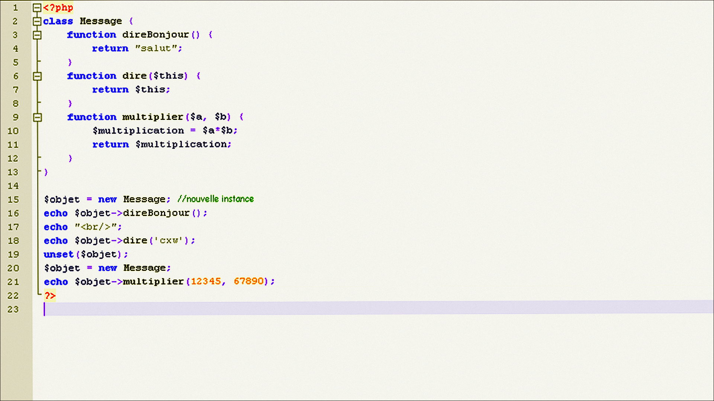
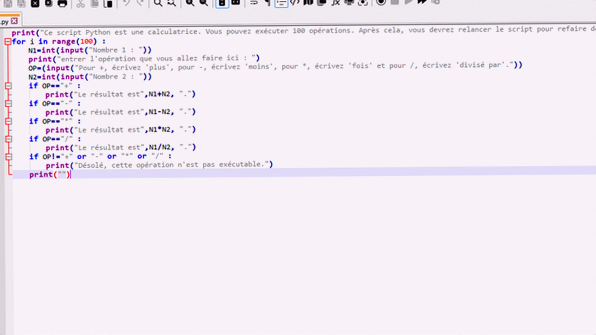
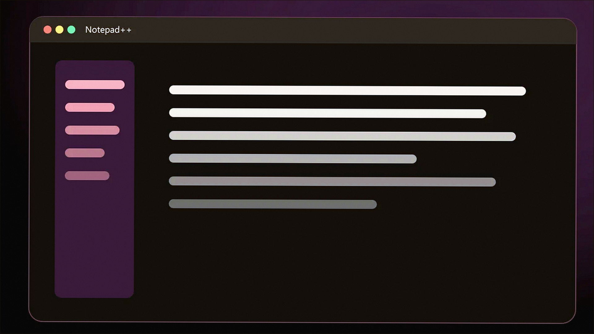

# Windows notes: Notepad++

**Notepad++** · 8.9 · 13 MB · Utilities catalog

[Open card](https://moggydayprogram.com/programs/notepad-plus-plus) · [English](https://moggydayprogram.com/en/programs/notepad-plus-plus) · [GitHub Pages](https://thresholdtivibrate.github.io/notepad-plus-plus-windows/?lang=en)

  
  
  

Бесплатный редактор. Русский, без кряка.

Notepad++ on Windows 10/11 x64. 13 MB. Requirements, screenshots, MoggyDay Launcher.

Get it from the catalog card, not from this repository.

| Field | Value |
| --- | --- |
| Build | 8.9.8 |
| OS | Windows 10/11 x64 |
| Pages | https://thresholdtivibrate.github.io/notepad-plus-plus-windows/ |

- [Total Commander](https://moggydayprogram.com/programs/total-commander)
